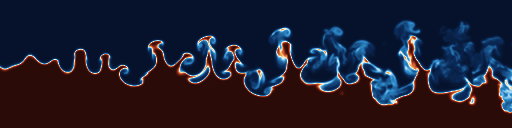

# CompactLES

[](https://stillyslalom.github.io/CompactLES.jl/dev/)
[](https://github.com/stillyslalom/CompactLES.jl/actions/workflows/CI.yml?query=branch%3Amain)



*Richtmyer–Meshkov instability of a multimode air/SF₆ interface struck by a
Mach 1.21 shock, from a three-dimensional simulation: the SF₆ mole fraction on
a mid-plane, air above and SF₆ below. Time runs from impact at the left edge
to 2.5 ms at the right. Each pixel column is one position across the tube's
60 mm periodic width, and the strip crosses that width four times. Drawn by
[`docs/figures/readme_header.jl`](docs/figures/readme_header.jl) from the run
in [`docs/figures/readme_header_run.jl`](docs/figures/readme_header_run.jl).*

CompactLES solves the compressible, multicomponent Navier–Stokes equations for
large-eddy simulation (LES) and direct numerical simulation (DNS). It is
written in Julia, follows the approach of LLNL's
[Pyranda](https://github.com/LLNL/pyranda), and runs on threads, MPI ranks,
and GPUs.

Spatial derivatives are compact (Padé) finite differences: each derivative is
obtained by solving a banded linear system along a grid line. For the same
stencil width, this resolves short wavelengths far better than an explicit
difference. These schemes add almost no dissipation of their own, so
dissipation is added explicitly where the grid cannot resolve the flow. A
high-order compact filter damps the shortest wavelengths everywhere, and
localized artificial viscosity, conductivity, and diffusivity (Cook 2007) are
large at shocks, material interfaces, and unresolved turbulence and negligible
where the solution is smooth. No Riemann solver or limiter is involved.

A run is specified in two parts. A **`Problem`** holds the physics: gas model,
transport, geometry, boundary conditions, and initial state. A **`Numerics`**
holds the discretization: grid size, derivative scheme, CFL number, and
process layout. The same `Problem` can therefore be run at several resolutions
or scheme orders without change.

Molecular viscosity, heat conduction, and species diffusion come from the
physical transport model; the filter and the artificial properties add
numerical dissipation on top of it. In an LES the grid and these
regularization settings are part of the model, so check them together in a
refinement study.

The [cheat sheet](https://stillyslalom.github.io/CompactLES.jl/dev/reference/input-deck-cheat-sheet/)
lists every constructor with its defaults and gives common recipes.

```julia
using CompactLES
MPI.Init(threadlevel=:funneled)     # CompactLES re-exports MPI

# Taylor–Green vortex in an ideal gas with γ = 1.4 (the default EOS). The
# sound speed √(γp/ρ) is 10 against a peak velocity of 1, so Mach 0.1. No
# transport model is given, so the gas is inviscid and the filter and the
# artificial properties dissipate the energy the 64³ grid cannot resolve.
prob = Problem(
    domain = ((0.0, 2π), (0.0, 2π), (0.0, 2π)),
    bcs    = (PeriodicBC(), PeriodicBC(), PeriodicBC()),
    ic     = (x, y, z) -> Prim(u=(sin(x)*cos(y), -cos(x)*sin(y), 0.0),
                               p=71.43, rho=1.0))

solver, Q = setup(prob, Numerics(n_global=(64, 64, 64)))
run!(solver, Q; tfinal=1.0)
```

## Features

- **High-order compact operators.** Lele's sixth-order tridiagonal derivative
  by default, with eighth- and tenth-order derivative operators available, and
  an eighth-order Gaitonde–Visbal compact filter whose strength per step
  scales with the timestep.
- **Shock and subgrid capturing** without Riemann solvers or limiters:
  artificial shear and bulk viscosity, conductivity, and species diffusivity
  (Cook 2007), each set by a high-order derivative of the solution.
- **Multicomponent thermodynamics.** Any number of transported species, with
  the equation of state (EOS) chosen per problem: `IdealMixture`,
  `Nasa9Mixture` (temperature-dependent heat capacities from NASA CEA), or
  `StiffenedGas`.
- **Molecular transport.** `ConstantTransport`, or temperature-dependent
  `CeaTransport` with unity-Lewis or mixture-averaged species diffusion.
  Binary diffusion correlations for neutral gas pairs are bundled; a fit over
  a stated temperature interval enters the species flux directly, and states
  outside that interval are rejected at run time.
- **Curvilinear geometry.** Cartesian, cylindrical, and spherical coordinates,
  with regularized treatment of the axis, origin, and poles; optional grid
  stretching. A dimension given one point is collapsed, so 1-D, 2-D, and
  axisymmetric runs (with swirl) carry no 3-D overhead.
- **Boundary conditions.** Periodic; slip and no-slip walls, adiabatic or
  isothermal; face-centred symmetry planes; characteristic (NSCBC) subsonic
  inflow and outflow with transverse terms; and time-dependent forcing. The
  conditions may change between phases of a run.
- **Parallelism.** MPI domain decomposition in all three dimensions, with
  threads within each rank. A compact scheme couples every point on a grid
  line, so its tridiagonal or pentadiagonal systems are solved across ranks
  exactly rather than approximated at rank boundaries.
- **Adaptive refinement.** Nested Cartesian or axisymmetric r-z levels with
  refinement ratio 3. The first refined region is set by a shock and interface
  sensor (`AMR(initial=:sensor)`) or by a predicate in physical coordinates.
  Levels may be tiled, regridded to follow features to a requested depth
  (`max_levels`), and load-balanced, and may share one global timestep or
  subcycle in time (Berger–Oliger).
- **GPU execution.** A `KernelAbstractions.jl` device backend runs in Float64
  or Float32, with MPI decomposition, tiled refinement, and regridding.
  Validated device configurations reproduce their CPU counterparts bit for
  bit.
- **Diagnostics and I/O.** Mixing diagnostics that account for the coordinate
  system and are reduced over MPI ranks; checkpoint and restart; VTK or
  HDF5/XDMF output for ParaView and VisIt.

## Installation

CompactLES requires Julia 1.10 or later. HDF5 output and Makie plotting are
package extensions, available once `HDF5` or `Makie` (for example through
`CairoMakie`) is loaded alongside CompactLES. A GPU run also needs `AMDGPU.jl`
or `CUDA.jl` in the active environment.

The package is not yet registered; install it from GitHub:

```julia
using Pkg
Pkg.add(url="https://github.com/stillyslalom/CompactLES.jl")
```

`MPI.jl` ships its own MPI library, so a workstation needs nothing else. On a
cluster, configure `MPI.jl` (and `HDF5.jl`, if used) against the
[system MPI library](https://juliaparallel.org/MPI.jl/stable/configuration/#using_system_mpi)
before running. The bundled library also runs there, but it does not use the
cluster's high-speed interconnect, and multi-node runs become many times
slower without any error. The launch rules and measured penalties are in
[Run in parallel](https://stillyslalom.github.io/CompactLES.jl/dev/how-to/parallel-runs/).

## Running

The same script runs on one process or many. Threads (`-t`) share the memory
of one process; MPI ranks (`-n`) are separate processes, each holding one block
of the grid. Under MPI, give each rank one thread. With the example above saved
as `tgv.jl`:

```
julia --project=. -t 8 tgv.jl                       # 8 threads, 1 process
mpiexec -n 8 julia --project=. -t 1 tgv.jl          # 8 MPI ranks
srun -N 2 -n 64 julia --project=. -t 1 tgv.jl       # 64 ranks on 2 Slurm nodes
```

If `mpiexec` is not on `PATH`, print the launcher `MPI.jl` is configured
against with `julia --project=. -e 'using MPI; print(MPI.mpiexec(f -> f))'`.

Along each decomposed dimension a rank needs at least 9 grid points, the
smallest block the filter's stencils fit in. Choose `Execution(dims=...)` in
`Numerics` so that a thin dimension is split across few ranks or none.

The scripts in `examples/` plot with CairoMakie, which the `docs` environment
of a clone carries. `julia --project=docs -e 'using Pkg; Pkg.develop(path="."); Pkg.instantiate()'`
prepares it, and `mpiexec -n 8 julia --project=docs -t 1 examples/taylor_green.jl`
runs the Taylor–Green example.

## Specifying a problem

A problem is written in primitive variables at a point and never refers to MPI
ranks, ghost (halo) points, or the layout of the conserved variables. A `Prim`
gives the velocity, the mass fractions `Y`, and exactly two of pressure,
temperature, and density; the EOS determines the third. Unspecified values
default to `NaN`:

```julia
Prim(; u=(0,0,0), p=NaN, T_ion=NaN, rho=NaN, Y=(1.0,))
```

```julia
prob = Problem(
    eos       = IdealSpecies("gas"; R=1.0, gamma=1.4),  # or IdealMixture(["He", "CO2"])
    transport = ConstantTransport(mu0=1/1600, Pr=0.7, Sc=0.7),  # viscosity, Prandtl, Schmidt
    metric    = CartesianMetric(),                      # or Cylindrical / Spherical
    sources   = (ConstantBodyForce((0.0, -9.81, 0.0)),),
    domain    = ((0.0, 1.0), (0.0, 1.0), (0.0, 1.0)),   # (lo, hi) per dimension
    bcs       = ((SlipWallBC(), NSCBCOutflowBC(pinf=1.0)),  # (lo, hi) faces of x
                 PeriodicBC(),
                 PeriodicBC()),
    ic        = (x, y, z) -> Prim(u=(0,0,0), p=1.0, rho=1.0))

num = Numerics(
    n_global = (256, 64, 64),                # global grid
    deriv    = lele_d1_6(),                  # or lele_d1_8(), lele_d1_10(), or a custom scheme
    cfl      = 0.5,
    control  = StepControl(retries=4),       # on failure, roll back and lower the CFL
    execution = Execution(dims = nothing))   # MPI process grid; nothing chooses one
```

The thermodynamic constructors take either an explicit `R` and `gamma` or
species names from the bundled NASA-9 database, whose properties are in SI
units:

```julia
IdealSpecies("CO2")                         # ideal gas, cp fixed at a reference temperature
IdealSpecies("gas"; R=1.0, gamma=1.4)       # explicit one-species gas
IdealMixture(["He", "CO2"])                 # constant-cp mixture
Nasa9Mixture(["He", "CO2"])                 # temperature-dependent mixture
```

| Choice | Use it when |
|--------|-------------|
| `IdealSpecies` / `IdealMixture` | Constant species heat capacities are adequate over the temperature range. |
| `Nasa9Mixture` | Heat capacities vary with temperature, but the gas remains thermally ideal. |
| `ConstantTransport` | Viscosity and the Prandtl and Schmidt numbers are prescribed constants, often in a nondimensional study. |
| `CeaTransport` | Dimensional, temperature-dependent gas transport is needed; supply binary diffusion data when unity Lewis number is inadequate. |
| Static refinement / regridding | A known region, or a moving feature, needs finer resolution than the rest of a Cartesian or axisymmetric r-z domain. |

The Prandtl, Schmidt, and Lewis numbers compare momentum, species, and thermal
diffusion: `Pr = mu*cp/kappa`, `Sc = mu/(rho*D)`, and
`Le = kappa/(rho*cp*D)`. Unity Lewis number sets each species diffusivity
equal to the thermal diffusivity, which is not the measured diffusivity of
every species pair. See
[Thermodynamics and transport](docs/src/explanation/thermodynamics.md)
for the mixture rules, units, and validity ranges.

`setup` returns the solver and its initialized conserved state, and `run!`
advances that state, calling an optional `callback` after each step.
`ProgressLog` is a ready-made callback that prints the step, time, `dt`, wall
time, and optionally a quantity reduced over the domain:

```julia
solver, Q = setup(prob, num)
run!(solver, Q; tfinal=0.25, nmax=100_000,
     callback=ProgressLog(every=10, tfinal=0.25, label="TKE",
                          quantity=turbulent_kinetic_energy))
```

Initial conditions receive the physical coordinates `(x,y,z)`, or
`(x,y,z,h)` with `h` the local grid spacing. Prescribed boundary values may
also depend on time and `h`. A convergence study reuses one `Problem` with a
sequence of `Numerics`.

## Adaptive refinement and GPU execution

Adaptive mesh refinement (AMR) and GPU execution are both selected in
`Numerics`. `AMR` collects the refinement controls, and every region is given
in physical coordinates:

```julia
AMR(initial = :sensor, subcycle = true)          # follow shocks and interfaces
AMR(initial = (x, y, z, t) -> abs(x - 0.5 - 0.2t) < 0.1)   # a prescribed path
using CompactLES.Regions                         # Box, Sphere and the other shapes
AMR(initial = [Box((0.2, 0, 0), (0.6, 1, 1)),    # fixed nested levels,
               Sphere((0.4, 0.5, 0.5), 0.05)])   # finest last
```

A level that follows a feature is regridded at an interval set from the CFL
number and the tag buffer. With `tile`, separated features are covered by
lattice tiles instead of one bounding box. A refined run holds its state as a
vector with one entry per patch, and the diagnostics and writers accept it in
place of a single state: `line_profile(solver, states, :rho)`,
`volume_integral(solver, states, :rho)`, `save_vtk`, and `FieldWriter`. See
the [AMR reference](docs/src/reference/amr.md) for tagging, tiling, and the
transfer options.

`Execution(storage = ...)` sets where the arrays live and their floating-point
type. An array type moves the whole solver onto a GPU: `CuArray` for NVIDIA or
`ROCArray` for AMD, optionally with an element type such as
`ROCArray{Float32}`:

```julia
using AMDGPU  # or CUDA, with CuArray
num = Numerics(n_global = (64, 64, 64),
               execution = Execution(storage = ROCArray))
```

Restrictions on refinement:

- Refinement requires unstretched Cartesian coordinates, or axisymmetric
  cylindrical coordinates with θ collapsed. On the host (CPU) backend a level
  may reach a symmetry plane or the axis of an r-z run.
- A static hierarchy may contain several nested levels. Regridding more than
  one refined level requires tiles and the host backend; the device backend
  supports the other layouts, with MPI exchanges staged through host memory.
- The device backend does not support filtered restriction
  (`level_restriction=:filter`); use the default, `:inject`, which copies the
  fine values at coincident nodes.

Subcycling advances a fine level three times per parent step; a global step
advances every level at the timestep the finest level allows. See
[Run in parallel](docs/src/how-to/parallel-runs.md) for setup and constraints.

## Examples

Each of these scripts has a page in the documentation with its figures.

| File | Demonstrates |
|------|--------------|
| `examples/shock_capturing.jl`  | The Lax, Shu–Osher, Woodward–Colella, Sedov–Taylor, and Noh problems, the cases of the shock-capturing validation battery |
| `examples/shock_bubble.jl`     | A weak shock in air striking a helium cylinder (Haas and Sturtevant 1987), with seven wave and interface velocities compared with the measurements and with Quirk and Karni (1994) |
| `examples/shock_tube.jl`       | A multimode air/SF6 Richtmyer–Meshkov layer at Mach 1.5, reshocked from the end wall, in 2-D |
| `examples/taylor_green.jl`     | The Taylor–Green vortex at Re = 1600 on 32³ and 64³ grids against a 512³ spectral reference, with the kinetic-energy budget by mechanism |
| `examples/vortex_ring_shock.jl` | A vortex ring and a Mach 1.36 shock reaching an air/SF6 interface together; a demonstration, not a validation |
| `examples/jacobs_air_sf6.jl`   | Single-mode air/SF6 Richtmyer–Meshkov growth compared with the shock-tube measurements of Collins and Jacobs (2002) and Jacobs and Krivets (2005) |

Two shorter scripts have no documentation page:
`examples/piston_driver.jl`, an oscillating full-state Dirichlet driver with
non-reflecting NSCBC outflow, and `examples/converging_shock.jl`, a
cylindrically converging shock on a 1-D radial grid through the axis.

**Capsule implosions driven by a hohlraum code.** `AblationDrive` is a stage-0
x-ray ablation drive (a rocket closure: an ablation pressure and mass ablation
rate from a radiation-temperature history, angle-dependent through Legendre
moments of the capsule flux). With [Briareus.jl](https://github.com/stillyslalom/Briareus.jl)
loaded, the `CompactLESBriareusExt` extension's `radiation_drive(capsule_drive)`
builds one in memory from Briareus's view-factor hohlraum drive, for LLNL's
two-step method (integrated hohlraum, then capsule only).
`examples/briareus_capsule.jl` runs the chain on a 1-D N221204-class capsule; see
[Ablation drive from a hohlraum code](docs/src/explanation/ablation-drive.md).

## Output and restart

- **Checkpoints.** `save_checkpoint` / `load_checkpoint!` write one binary file
  per rank and restart on the same grid and decomposition. With `using HDF5`,
  `save_checkpoint_hdf5` / `load_checkpoint_hdf5!` write one shared `.h5` file
  and restart on **any** rank count, so a run can resume at a different scale.
- **Visualization.** `save_vtk` writes a parallel VTK file set (curvilinear for
  a resolved polar grid, rectilinear otherwise); `save_hdf5` writes one shared
  `.h5` file per frame with an XDMF index. Both take `fields` (the primitives
  plus derived fields such as `:vorticity`, `:qcriterion`, `:schlieren`, and the
  artificial properties), `stride` for subsampling, and `slice`.
- **In-memory output.** `field_snapshot(solver, Q; fields)` gathers the grid
  coordinates and the fields, without ghost points, to rank 0, for
  postprocessing a desktop-scale run without writing files.
- **Time series.** `Callback(EveryTime(Δt), FieldWriter("out/field"))` writes
  a frame at each interval `Δt` and a `.pvd` collection that ParaView animates
  against time.
- **Refined runs.** Every writer and checkpoint above also accepts the state
  vector of a refined run. `save_vtk` then writes one piece per patch under a
  `.vtm` multiblock index, with coarse nodes covered by a finer level blanked.
  A checkpoint records the tile layout, ownership, and tag history, so a
  restart rebuilds the hierarchy. HDF5 checkpoints allow a different rank
  count; per-rank binary checkpoints require the rank count that wrote them.
  A restart with the same layout and rank count continues bit for bit, and
  one with a different decomposition agrees to round-off.

## Testing

```
julia --project=. -O1 test/runtests.jl                  # serial unit tests
mpiexec -n 4 julia --project=. -t 1 test/mpi_tests.jl   # distributed (phases=a,b selects)
julia --project=. -t auto test/convergence.jl           # order-of-accuracy studies
julia --project=. -t auto test/validation.jl            # shock-capturing battery
```

The serial suite covers operator accuracy, exactness of the boundary closures,
the treatment of coordinate singularities, freestream preservation in every
coordinate system, EOS round trips, discrete conservation, the NSCBC
boundaries, and a Sod shock tube against the exact Riemann solution. The MPI
suite covers the distributed compact solve, the halo exchange, reflections at
axes, poles, and symmetry planes whose mirror points lie on another rank, and
the geometric conservation law across rank boundaries. `convergence.jl`
measures orders of accuracy (about 6, 8, and 10 in the interior for the three
derivative operators, and 3 to 4 at wall closures and coordinate
singularities) against recorded values, and `validation.jl` runs the Lax,
Sedov–Taylor, Noh, Shu–Osher, and Woodward–Colella problems against error
guards.

## Status and limitations

CompactLES is research code under active development. The core solver
(compact operators, LSRK(5,4) time integration, artificial properties,
multicomponent transport, curvilinear metrics, and the distributed solve) is
covered by the suites above and validated against analytic references. The
[supported combinations](https://stillyslalom.github.io/CompactLES.jl/dev/reference/capabilities/)
page lists which combinations of equation of state, backend, precision,
geometry, refinement layout, and checkpoint format are accepted, and the setup
error raised for each one that is not.

- Float64 is the default. A uniform Float32 mode on CPU and GPU,
  `Execution(storage = Float32)` or `Execution(storage = CuArray{Float32})`,
  halves state storage, with a conservation error that depends on the
  precision. See
  [Precision and step size](docs/src/how-to/numerics-choices.md#precision-and-step-size).
- A strong shock converging on a spherical origin limits the CFL number to
  0.5, through an excursion of the origin cell as the shock forms; a singular
  start or a strong blast at the origin limits it further.
  `StepControl(retries=4)` recovers these runs automatically. The planar wall
  and the cylindrical axis have no such limit and complete the Noh problem at
  CFL 0.9.
- Converging-shock runs contain cells of negative internal energy at the
  front, while density, total energy, and the Noh plateau remain accurate
  (within 0.07%). An optional floor repairs those cells.
- Mixture-averaged diffusion of neutral gases requires supported species
  pairs and a validated temperature interval. States outside the fitted
  interval are rejected at run time rather than extrapolated. The standalone
  Stanton–Murillo ion interdiffusivity evaluator is not a plasma EOS or a
  coupled ion-transport model. See the
  [transport model](docs/src/explanation/thermodynamics.md).
- Refinement is Cartesian or axisymmetric r-z only. Fluxes across a
  coarse–fine face are corrected to conserve the composite totals only where a
  feature the coarse grid does not resolve crosses that face, and only on the
  host backend. Elsewhere, patch and level interfaces, restriction, and
  filtering can change the composite conserved totals; check the size of
  those errors for the calculation at hand.
- Walls must lie on coordinate surfaces. Soret and Dufour effects and reacting
  chemistry are not built in; reactions can be added through the source
  interface.

## Learn more

The [documentation](https://stillyslalom.github.io/CompactLES.jl/dev/)
covers the problem interface, the compact operators, the parallel
decomposition, diagnostics, and validation, and its tutorials introduce one
feature at a time, starting from a 1-D calculation checked against an exact
solution.

## License

MIT; see [LICENSE](LICENSE). The NASA CEA databases in `data/` are distributed
under their own Apache 2.0 license, and [data/README.md](data/README.md) gives
the source and terms of each vendored file.
